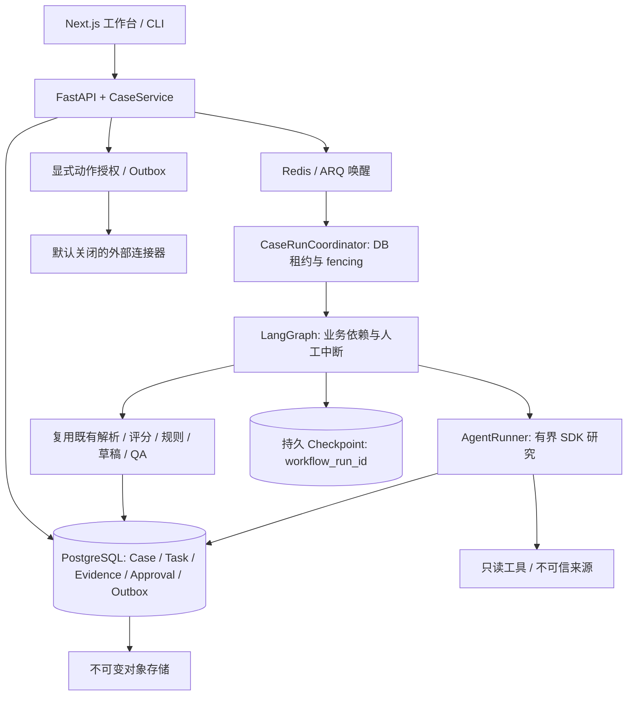

# TradeCase 完整工作台交付报告

2026-10-28。本次以用户提供的完整实施方案为目标，在原有业务包上增量实现。代码分支 `codex/tradecase-complete`；准确提交记录以 Git 为准。本报告将代码实现、本地执行验证和外部环境验收分开。没有向生产发布，没有调用付费模型，也没有发送真实邮件或写入 CRM。

## 基线与复用

实际仓库位于 `tradecase-v1/`，开始时干净，HEAD 为 `3a4f8b4`，在 `codex/tradecase-v1`，包含用户提到的 `e446f94`。开始时实际测试 **347 项通过**，与此前报告的 315 项不同；本次没有用旧报告代替测试。

保留原来的解析器、企业候选、证据评分、两类规则、草稿、QA、报告、严格校验、CLI 和三个 canonical Skills。新增 `tradecase.platform`，通过兼容桥调用原函数。旧 filesystem Case 仍独立可用；工作台以数据库为唯一业务记录，文件夹只作可丢弃的业务内核输入。详见 [复用审计](architecture/adr-002-reuse-audit.md) 与 [Skill 角色及 I/O](../skills/CATALOG.md)。

## 实现与证据对应

| 工作包 | 实际交付 | 验证依据 |
|---|---|---|
| 数据库与对象 | SQLAlchemy 租户业务表、两个 Alembic 迁移、不可变原询盘/产物、复合外键；本地内容寻址对象与可替换 S3 | 持久化、跨租户、并发、迁移、对象 hash/symlink 测试；真实 PostgreSQL；S3 使用注入模拟客户端 |
| 工作流 | 实际 LangGraph StateGraph；三类并行调查、合并/冲突、有限补查、旧规则/评分、质量门禁、独立审批准备与 interrupt、报告和跟进 | 图重放、独立进程重启、SQLite/Postgres checkpoint、审批批准/拒绝/改稿/补证据测试 |
| Agent 与工具 | OpenAI Agents SDK 适配协议和真实 SDK 调用路径；Fake model；六类只读工具契约、预算/超时/频控、精确来源与快照引用验证 | 使用 SDK Model 测试替身运行真实 SDK loop；工具越权、注入、假引用、费用预算、不可恢复 runtime 测试；未运行真实模型请求 |
| 调度 | DB Task lease、token fencing、Attempt/AgentRun、依赖、幂等、退避、最大尝试次数；ARQ 仅唤醒 | 双 Worker 竞争、过期租约、重复 ARQ 投递只有一次有效执行、失败 Task 定时重试、跟进提醒事件 |
| 业务 API | FastAPI/严格输入 schema、token 哈希/RBAC、Case 导入/查询/编辑、任务、证据、规则、审批、版本、跟进、导出、SSE 补拉、指标 | API 合成场景；权限/租户、字段伪造、上传体积/类型、原始字节、事件脱敏和重连测试 |
| 人工证据 | 人工快照与逐字引文；明确记录人工上传和未在线抓取；审核员将既有 Claim–Source 链接绑定到企业、信号和现行规则 | 非 synthetic 数据 schema 下，人工提供的测试资料经审核达到原引擎 70 分、两类规则结果，再走审批/跟进；只是契约测试，不是在线事实证明 |
| 知识与缓存 | 租户知识版本、有效期、历史原文；资料默认未核实；跨 Case URL+权限策略缓存、TTL 与并发合并 | 知识隔离/过期/版本、缓存并发/权限键/原采集时间测试 |
| Web GUI | Next.js Case 队列、详情、证据快照、Inbox、草稿/版本比较及称呼/结尾语气预览、跟进、知识、人工证据复核、设置；批量显式启动调查 | Chromium 实际浏览器验收，详情见 [前端验收记录](../frontend/design/acceptance.md) |
| 外部动作 | 独立 draft_review 与 mail_send/crm_sync 范围；Outbox；SMTP 可配置适配器；Fake Mail/CRM；精确版本、哈希和逻辑动作去重 | 并发 FakeMail 只调用一次；编辑/审批竞态、不确定回执、合成到真实连接器阻断、默认关闭、PENDING 撤销测试 |
| 运维 | 锁定依赖、非 root 应用容器、Compose、初始化/迁移、备份/新环境恢复、对象完整性、保留/删除/GC、CI 配置 | 本地容器与恢复执行证据、wheel 独立安装、保留 dry-run/版本/租户/路径测试。远程 CI 尚未运行 |

Workflow 决定业务路径；Task Manager 决定谁可以执行工作及何时重试；Agent Run 记录一次实际执行；CaseService 管理业务状态与授权。Checkpoint 只是流程游标。没有两个业务总调度器，也没有依靠模型输出直接授权外发。

## 实际执行记录

- 开始回归：347 passed，见 [baseline-pytest.log](evidence/full-delivery/baseline-pytest.log)。
- 最终 Python **468 passed、4 skipped（83.17 秒）**；lint、compile、原许可证检查和源文件复用检查均通过：结果见 [full-check.log](evidence/full-delivery/full-check.log)。其中基础设施用例默认跳过，在单独的真实服务测试执行；不能把 skipped 算通过。
- PostgreSQL 17.6 / Redis 7.4.6：**4 项通过**，包括迁移 up/down、并发 fencing、真实 ARQ、pg_dump/restore 与同 checkpoint 恢复，见 [infrastructure.log](evidence/full-delivery/infrastructure.log)。
- 七组工作台合成 Case 均到达持久人工审批点；同名冲突、未知规则、推断邮箱、提示注入保持 PARTIAL。见 [platform-scenarios.json](evidence/full-delivery/platform-scenarios.json)。该批 7 个本机 SQLite 样本中位 0.7715 秒，P95 最近秩 1.9675 秒，仅测创建到审批中断，不含人工时间；与其他测试/构建并行，不能作为生产 SLA。
- 完整 Compose：通过 Next.js 代理创建 Case，真实 ARQ/PG 到达审批；停止写入后备份数据库和对象，在新项目恢复 **22 个对象引用**，使用同一 workflow ID 继续审批到 `READY_TO_FOLLOW_UP`，生成 1 个跟进，外发返回 403。用时 137.771 秒，见 [compose-acceptance.json](evidence/full-delivery/compose-acceptance.json) 与 [日志](evidence/full-delivery/compose-acceptance.log)。
- 浏览器 **12 项通过（3 项真实本地 API 流程、9 项受控 UI 场景）**，类型检查、生产构建和格式检查通过，见 [frontend/design/acceptance.md](../frontend/design/acceptance.md)。实际 API 场景使用本地 PostgreSQL和合成资料，没有真实发送。
- 最终前端补齐语气预览与撤销入口后再次构建生产镜像并重跑完整 Case 闭环，见 [compose-final-smoke.json](evidence/full-delivery/compose-final-smoke.json)；该次明确 `actual_backup_restore=false`，真实恢复证据是上一项。镜像与源码绑定见 [compose-release-images.json](evidence/full-delivery/compose-release-images.json)。两套临时验收环境已清理，本地开发预览基础设施保留，见 [清理记录](evidence/full-delivery/compose-cleanup.json)。
- wheel 重新构建后，在新的独立环境以 `python -I` 安装并运行原 CLI demo 与 strict validate，见 [构建日志](evidence/full-delivery/wheel-build.log)、[独立安装日志](evidence/full-delivery/wheel-standalone.log)。
- 三个 Skills 的 Codex/Claude 安装与原文 hash 一致，见 [skill-install.json](evidence/full-delivery/skill-install.json)。
- 独立 Agent 对安全边界的审查、发现和修复、精确文件 hash 与实际测试，见 [SECURITY_REVIEW.md](architecture/SECURITY_REVIEW.md)。这是限定范围的独立复核，不是第三方渗透测试或人类验收。

## 关键验收矩阵

| 规格第 11.2 项 | 执行用例或证据 |
|---|---|
| 1 企业歧义；2 来源冲突 | `tests/integration/test_buyer_research.py`、`tests/unit/test_assessment.py`、七组合成工作台结果 |
| 3 来源不可访问 | `test_runtime.py`、`test_source_cache.py`、`test_api.py` 与受控公共读取实测阻断记录 |
| 4 提示注入 | `test_runtime.py`、`test_api.py`、前端来源文本安全场景；工具注册中没有外发工具 |
| 5 并行 Task | `test_tasks.py`、`test_workflow.py`、PostgreSQL 竞争测试 |
| 6 预算停止 | `test_runtime.py`、`test_coordinator.py`；有限轮数/时间/工具量与费用保留 |
| 7 Worker 崩溃 | `test_workflow.py` 独立进程重启、`test_deployment.py` PostgreSQL 租约恢复与 checkpoint 恢复 |
| 8 重复投递 | `test_tasks.py`、真实 ARQ、`test_actions.py` 同逻辑动作只调用一次 FakeMail |
| 9 改稿失效 | `test_actions.py`、`test_api.py` 与浏览器真实 API 改稿/重新审批 |
| 10 人工审批 | `test_workflow.py`、`test_api.py`、`test_review_inputs.py`、真实浏览器 |
| 11 回执不确定 | `test_actions.py` DELIVERY_UNCERTAIN、禁止自动重试、人工核对和迟到回执保护 |
| 12 租户隔离 | persistence/API/intake/knowledge/review_inputs 测试和独立 API 探针；浏览器切换租户丢弃旧响应 |
| 13 数据安全 | runtime/storage/API/maintenance 测试；SSRF、原文不执行、实际请求体积、hash、路径、日志脱敏 |
| 14 完整 GUI | 前端验收记录中的真实 API 全流程；其余 UI 场景明确标为 mock |
| 15 服务与数据恢复 | 真实 `pg_dump`/`pg_restore`、对象引用完整性与全新 Compose 项目同 workflow 续跑 |

这些验证允许复现技术行为，不证明合成来源事实为真或真实业务风险已被排除。

## 外部环境与产品边界

| 能力 | 已有代码/本地证据 | 尚未验证或需要部署环境 |
|---|---|---|
| 真实模型 | SDK 适配器、注入真实 SDK Model 契约测试、显式 live smoke 命令 | 本次无授权付费调用及 API 凭据，未做真实 API smoke；不能宣称在线 Agent 成功 |
| 公共网页 | 复用 ContentReader，SSRF/DNS pinning、重定向检查、robots、allowlist、缓存和失败分类 | WTO 受控读取实测被环境的非公网 DNS 地址阻断，网络请求 0，见 [smoke](evidence/full-delivery/public-reader-smoke.json)；没有绕过 |
| 注册库/搜索/动态浏览器 | 统一只读注册表与 unavailable 状态；可替换接口 | 付费、许可、登录与动态浏览器没有接入；Web Access/Crawl4AI 没有冒充在线服务 |
| 邮件/CRM | 文件导入、独立动作审批、Fake receipt、SMTP 适配器、CRM 替换接口 | 无邮箱账户同步；无实际 SMTP/商业 CRM 联调；真实发送和 CRM 写入 **0 次** |
| 对象存储 | 本地卷经真实恢复；S3 endpoint/SSE/内容 hash 配置与模拟客户端测试 | 没有真实 S3 服务可用性、权限和加密密钥验收 |
| 附件 | `.eml` 原字节保存、附件元信息、体积/类型门禁；不执行附件 | 未集成杀毒服务；任意二进制附件内容提取默认不可用，应由受控扫描转换服务提供 |
| 生产治理 | 个人 token 哈希、租户角色、操作审计、保留工具、模型/预算/工具配置 | 凭据由部署方 secret manager 注入；团队配置通过管理员 CLI，模型/预算通过部署配置，GUI 展示配置；尚无企业 SSO/图形化组织管理 |
| 上线质量 | 本地 CI 等价检查、真实浏览器/数据库/队列、部署恢复 | 未推送/运行远程 CI；未生产发布；无真实经营转化率、生产负载容量、用户设计批准或目标用户试用数据 |

这些限制不是在线成功。真实业务资料在来源不足时保留 UNKNOWN/PARTIAL，并交人工确认；不会用测试夹具填充真实调查。

## 安全与恢复结论

外发始终先校验当前版本 draft_review，再申请独立动作审批，排队与 dispatch 重新核验同租户、作用域、有效期、内容 hash、真实对象字节及风险门禁。拒绝/改稿/补证据决定在事务内撤销旧动作审批，发送中和回执不确定时阻断修改。提供商不支持幂等时，网络歧义停在 DELIVERY_UNCERTAIN，人工核对后也不盲目重发。未 dispatch 的排队动作可以明确取消，关闭 Case 自动取消它们。

保留清理默认 dry-run，只能对达到保留条件且关闭的案件执行；删除前验证版本、租户和全部路径。业务 DB、检查点、原始兼容目录、历史 review 目录及崩溃 staging 目录一起处理，避免仅删数据库却残留询盘。共享对象由全局引用检查保护，物理 GC 需要应用静止及宽限期。见 [RETENTION.md](RETENTION.md)。

依赖版本固定在 `uv.lock` 与 `frontend/package-lock.json`。许可证元数据清单及原有代码复用检查有证据；它不是所有新增依赖的法律审查意见，见 [THIRD_PARTY_NOTICES.md](../THIRD_PARTY_NOTICES.md)。

## 交付入口

- [使用说明](WORKBENCH_USAGE.md)：启动、个人令牌、完整业务操作、审批与导出。
- [部署说明](WORKBENCH_DEPLOYMENT.md) 与 [ops/README.md](../ops/README.md)：Compose、配置、备份、恢复与回滚边界。
- [OpenAPI](../contracts/workbench-openapi.json)、[Agent 输入](../contracts/agent-task-request.schema.json)、[Agent 输出](../contracts/agent-task-result.schema.json)、[人工审核输入](../contracts/review-inputs.schema.json)。
- [ADR 001](architecture/adr-001-platform-boundaries.md)、[ADR 002](architecture/adr-002-reuse-audit.md)、[ADR 003](architecture/adr-003-runtime-workflow.md)、[ADR 004](architecture/adr-004-ops.md)。

本地交付可以复现完整的 Case → 调查 → 来源 → 审核 → 草稿 → 跟进闭环；生产外部连接的验收仍需真实服务环境与对应授权。所有真实外发开关维持默认关闭。
